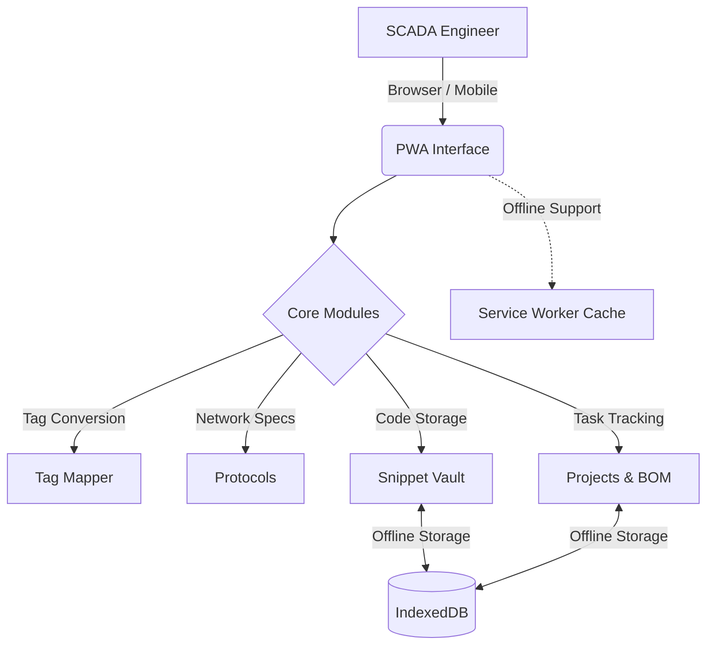

# ⚙️ PLC-Connect Hub

  

**An offline-first Progressive Web App (PWA) designed for SCADA integration, cross-brand tag mapping, and deployment management.**

---

## 🏗️ System Architecture



*(GitHub natively renders the diagram above. If viewing locally, it represents the offline-first data flow of the application).*

---

## ✨ Features

* 🔀 **Tag Mapper:** Instantly convert Siemens S7 and Allen-Bradley PLC addresses to Wonderware SCADA syntax. Supports bulk CSV import/export for rapid database generation.
* 📡 **Protocols:** Built-in Modbus register calculator (instantly map holding registers to function codes/offsets) and IP:Port quick-copy utilities for OPC UA, S7, and EtherNet/IP.
* 💾 **Snippet Vault:** Write, format, and save SQL queries and Wonderware QuickScripts. Data is saved locally in the browser via IndexedDB—no internet required.
* 📋 **Projects & BOM:** Track site surveys using a Kanban board and calculate Bill of Materials (BOM) estimates in AED with automated 5% VAT totals.
* 🧭 **Interactive Tour:** First-run guided product tour for onboarding.

---

## 🚀 Getting Started (New Users)

1. **Access the App:** Open the hosted GitHub Pages link on your desktop or mobile device.
2. **Take the Tour:** On your first visit, the app will automatically launch an interactive spotlight tour explaining how to use each tool.
3. **Replay the Guide:** If you forget a step, click the `? Help` button in the top right corner to replay the interactive guide. *(To manually hard-reset the tour memory, clear the `plch_tour` key in your browser's Developer Tools > Local Storage).*
4. **Install Offline:** Look for the "Install App" icon in your browser's address bar to save it directly to your device for offline use on factory floors.

---

## 💻 Developer Setup & Deployment

### Run Locally

To run the application on your local machine for development:

```bash
npm start

```

*(Note: You can use any static file server. However, Service Workers require either `http://localhost` or a valid HTTPS connection to function).*

### Deploy to GitHub Pages

1. Push your code to the `main` branch.
2. Navigate to your repository **Settings > Pages**.
3. Set the **Source** to **GitHub Actions**.
4. The pre-configured `.github/workflows/deploy.yml` will automatically build and publish the site upon every push.

### Pre-Flight Checklist

Before going live in production, ensure you complete the following:

* [ ] Replace the `USERNAME` and `REPO` placeholders in `sitemap.xml` and `robots.txt`.
* [ ] Update the contact email address in `security.txt`.
* [ ] **Bump the version number (`V`)** inside `service-worker.js` whenever you modify any HTML, CSS, or JS file. This forces client browsers to download the updated cache.

---

## ⚠️ Important Engineering Note

**DAS Item Syntax:** Address syntax varies slightly between `DASSIDirect`, `DASABCIP`, and `DASABTCP` driver versions. Always verify a few generated items against your specific SMC/DAServer configuration before executing a bulk CSV import into Wonderware.

```

```
